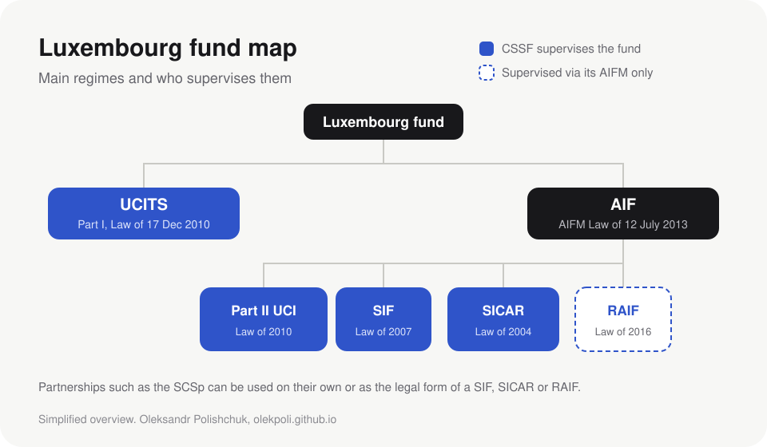

If you start working around Luxembourg funds, two acronyms show up in the first week: **UCITS** and **AIF**. Everything else (SIF, RAIF, SICAR, Part II) is a variation on one of them. This is the short version I wish I had on day one, with links to the official texts so you can check every line.

## UCITS: the fund your neighbour can buy

UCITS funds follow the [UCITS Directive (2009/65/EC)](https://eur-lex.europa.eu/eli/dir/2009/65/oj). Because they are open to ordinary savers, the directive regulates the **product itself**:

- the fund can only hold certain liquid assets, mostly listed securities and money market instruments
- it must spread risk, known as the 5/10/40 rule: at most 10% in one issuer, and all positions above 5% together can't exceed 40% (Article 52 of the directive)
- investors must be able to redeem their units regularly

The reward for following these rules is the **passport**. A UCITS authorised in one EU country can be marketed to retail investors across the EU. It is a big part of why Luxembourg became a hub for funds sold across borders.

## AIF: everything that is not a UCITS

An AIF is defined by exclusion: any collective investment fund that is not a UCITS. Private equity, real estate, infrastructure, private credit and hedge funds all sit here.

The key difference is *who* is regulated. The [AIFM Directive (2011/61/EU)](https://eur-lex.europa.eu/eli/dir/2011/61/oj) mostly regulates the **manager** (the AIFM): its capital, risk management, depositary, reporting. The fund gets much more freedom on what it invests in, and in exchange it is usually sold to professional or well informed investors.

## Where Luxembourg structures fit

Luxembourg turned both families into a set of local regimes. The diagram below is my simplified map.

| Structure | Law | Family | CSSF supervision |
|---|---|---|---|
| Part I UCI | [Law of 17 December 2010](https://legilux.public.lu/eli/etat/leg/loi/2010/12/17/n9/jo) | UCITS | Yes |
| Part II UCI | [Law of 17 December 2010](https://legilux.public.lu/eli/etat/leg/loi/2010/12/17/n9/jo) | AIF | Yes |
| SIF | [Law of 13 February 2007](https://legilux.public.lu/eli/etat/leg/loi/2007/02/13/n1/jo) | Usually AIF | Yes |
| SICAR | Law of 15 June 2004 | Usually AIF | Yes |
| RAIF | [Law of 23 July 2016](https://legilux.public.lu/eli/etat/leg/loi/2016/07/23/n7/jo) | Always AIF | No, only through its AIFM |

The RAIF is the interesting one. It was built from the SIF law but without the CSSF approval step, so it can launch faster. The catch: it **must** be an AIF managed by an authorised AIFM (Article 1 of the RAIF law), and supervision comes through that manager, which is regulated under the [AIFM Law of 12 July 2013](https://legilux.public.lu/eli/etat/leg/loi/2013/07/12/n1/jo).

## What changed in April 2026

Both directives were updated by [Directive (EU) 2024/927](https://eur-lex.europa.eu/eli/dir/2024/927/oj), often called AIFMD II and UCITS VI. Luxembourg transposed it through the law of 3 March 2026 ([bill n°8628, Chambre des Députés](https://wdocs-pub.chd.lu/docs/Dossiers_parlementaires/8628/20260212_TexteVote.pdf)), which applies from 16 April 2026, with some reporting rules following in April 2027.

The changes that matter most day to day:

- **Liquidity management tools.** Open-ended AIFs and UCITS must pick at least two tools from an EU list, such as redemption gates or swing pricing.
- **Loan origination.** AIFs that lend directly to companies now have a common EU rulebook.
- **Delegation and reporting.** Managers must explain more clearly what they delegate and to whom.

## So why write this?

Because the official texts are precise, but you can’t picture the whole thing from them. So I’m drawing the picture. This post is the first piece of **FundReg Atlas**, my visual guide to EU and Luxembourg fund rules.

## Sources

All official texts.

- [Directive 2009/65/EC (UCITS)](https://eur-lex.europa.eu/eli/dir/2009/65/oj), EUR-Lex
- [Directive 2011/61/EU (AIFMD)](https://eur-lex.europa.eu/eli/dir/2011/61/oj), EUR-Lex
- [Directive (EU) 2024/927 (AIFMD II / UCITS VI)](https://eur-lex.europa.eu/eli/dir/2024/927/oj), EUR-Lex
- [Law of 17 December 2010 on undertakings for collective investment](https://legilux.public.lu/eli/etat/leg/loi/2010/12/17/n9/jo), Legilux
- [Law of 13 February 2007 on specialised investment funds](https://legilux.public.lu/eli/etat/leg/loi/2007/02/13/n1/jo), Legilux
- [Law of 12 July 2013 on alternative investment fund managers](https://legilux.public.lu/eli/etat/leg/loi/2013/07/12/n1/jo), Legilux
- [Law of 23 July 2016 on reserved alternative investment funds](https://legilux.public.lu/eli/etat/leg/loi/2016/07/23/n7/jo), Legilux
- [Bill n°8628, text adopted on 12 February 2026](https://wdocs-pub.chd.lu/docs/Dossiers_parlementaires/8628/20260212_TexteVote.pdf), Chambre des Députés

> Spotted a mistake or want to add something? Email me from the [home page](/#contact).
